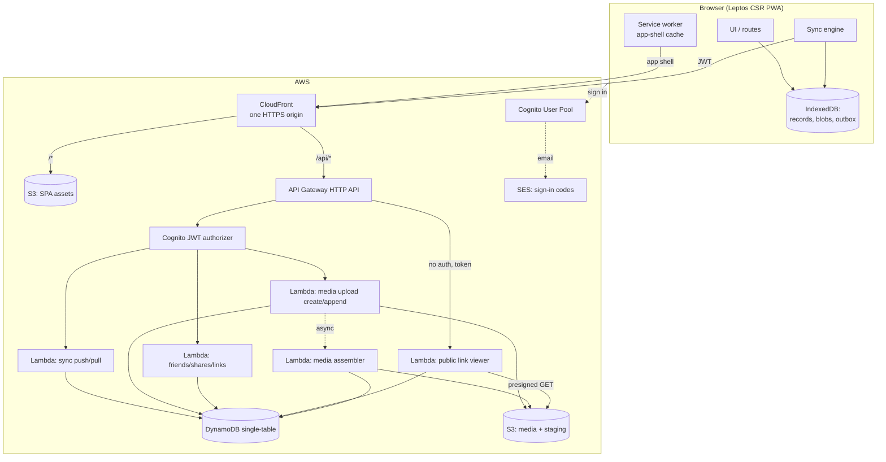
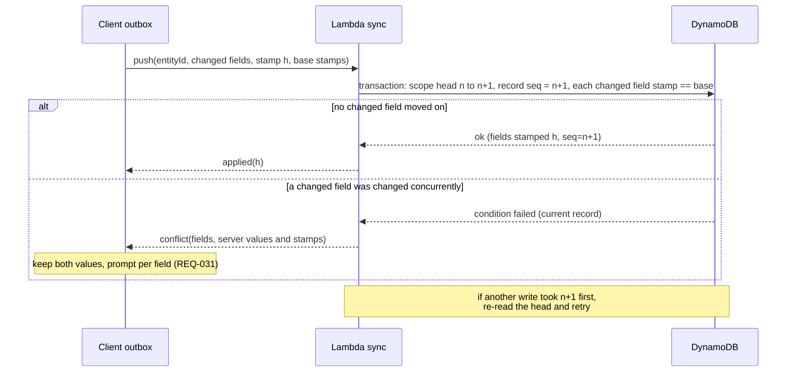
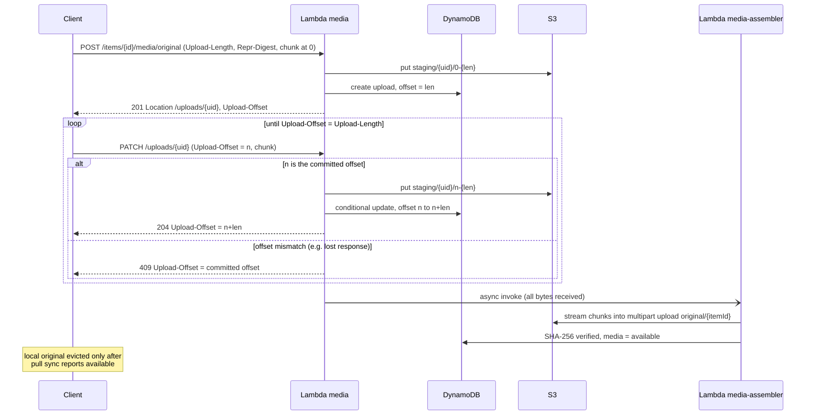

# Travel Records — High-Level Design (HLD)

> Scope: system-wide architecture for the offline-first POC. Component-level detail lives in `docs/lld/`; point decisions and their rationale live in `docs/adr/`. Requirement IDs (REQ-NNN) refer to `docs/requirements.md`.
>
> **Stack:** Leptos CSR SPA + PWA · CloudFront · Rust on AWS Lambda + API Gateway (HTTP API) · DynamoDB (metadata) · S3 (media) · Amazon Cognito (auth).

## 1. Architecture overview

The system is a **local-first PWA** backed by a **serverless Rust API**. The client is the source of truth while offline; the server is the durable, shareable system of record once a user signs in. All write paths flow through a client-side **outbox** that is reconciled with the server by a **sync engine**.

### Component responsibilities
- **Leptos PWA** — capture, browse, edit, map view; renders entirely client-side; installable; works fully offline (REQ-018, REQ-020).
- **IndexedDB** — single local store for records, media blobs, and the outbox queue (REQ-019, REQ-022).
- **Sync engine** — drains the outbox in staged priority order, pulls server deltas, surfaces conflicts and sync status (§4, REQ-023–REQ-029).
- **Service worker** — caches the app shell so the SPA boots offline (REQ-018).
- **CloudFront** — one HTTPS origin: serves the SPA from S3 and forwards `/api/*` to API Gateway, so the app never makes cross-origin API calls (ADR-0005).
- **API Gateway (HTTP API)** — behind CloudFront; JWT authorizer for owner routes, a separate unauthenticated route for public-link viewing.
- **Lambda functions (Rust)** — partitioned by concern: sync, media upload, media assembly, sharing/social, public viewer (§5).
- **DynamoDB** — all metadata (single-table design, §6).
- **S3** — media originals, downsized previews, chunk staging, and location-free copies of public videos (§7).
- **Cognito** — user identity and JWT issuance; the app's own sign-in screens call it directly, and it emails sign-in codes through SES. Involved only at and after sign-in (§3).

## 2. Client architecture (Leptos)

- **Rendering:** CSR SPA. No SSR; the only externally fetched HTML is the public share page, which is also served by the SPA shell + a public API call (kept simple for the POC; SEO is a non-goal).
- **Local data layer:** a thin Rust/WASM repository over IndexedDB. Everything the UI reads comes from IndexedDB; the network is never on the UI's critical path.
- **Outbox pattern:** every mutation writes the entity to IndexedDB **and** appends an operation to the outbox in one logical step (REQ-012). The UI reflects the local write immediately; the sync engine propagates it later. While the user is a guest, changes are not queued; migration queues the current state (§3).
- **Client-generated IDs:** entities get client-side UUIDs at creation so they are referenceable offline and stable across sync (REQ-008).
- **Media pipeline (client):** on capture, the client produces a **downsized preview** (for a video, a still frame taken from it), strips location from it, and keeps the **original**. Preview + original are both stored locally and queued for staged upload, so others can see a video's still frame before its original arrives (REQ-024, REQ-025).
- **Travels (client):** the owner's devices apply the auto-add rule offline. An item joins a private travel when its local capture time falls within the travel's dates, unless the owner excluded it; an item without a capture time uses its local added time instead. The rule re-runs when items are added, capture times change or dates change. Changing the dates of a private travel that is in progress or finished first shows how many items will be added and removed (REQ-081). Shared and public travels get a full-screen review queue instead (REQ-071–REQ-077, REQ-082, ADR-0007). Albums can be created, or extended, from travels in progress or finished, by picking the user's own items (REQ-079, REQ-080).

## 3. Identity & auth

Decided in [ADR-0002](adr/0002-guest-identity.md) and [ADR-0009](adr/0009-sign-in.md).

- **Three identities on a device:**
  - a **device ID**, generated at first launch and kept for the life of the installation;
  - one **local profile** that owns all local data, either a guest or bound to an account;
  - the **account**, a Cognito user identified by `sub`.

  The server takes ownership from the JWT `sub`, never from client-supplied fields.
- **Guest = local-only identity.** First launch creates a guest profile on the device with no network call, so the app is usable with zero connectivity (REQ-001, REQ-002). Guests cannot sync or share (REQ-003), so they need no Cognito identity.
- **Guest data protection:** guest content exists only on the device. The app requests persistent storage on the first save (REQ-054), and prompts the guest to sign in, or to install the app if persistence was refused, without blocking local use (REQ-055).
- **Sign-in** happens in the app's own screens, which call the Cognito user-pools API directly; nothing redirects or leaves the app (REQ-083).
  - The user enters an email address and a one-time code emailed to it through SES. There are no passwords, and a new address gets an account in the same step.
  - An attempt survives the app being closed while the user reads their email (REQ-084).
  - API calls carry the access token, which API Gateway checks with a Cognito JWT authorizer (REQ-003).
- **Guest→account migration:**
  1. If the account already has content, the user confirms what will be added; cancelling aborts the sign-in (REQ-056).
  2. The client then re-stamps guest records with the account's `sub`, binds the profile, and queues one create per entity with its current state. Guest edit history is never replayed.
  3. Normal sync pushes the creates. Unmigrated items are retained and retried on failure (REQ-004, REQ-005).
- **Account binding:** a bound profile never changes account. Unsynced changes are never uploaded to a different account; the user must sign in to the original account or discard them (REQ-057).
- **Sign-out:** after a warning if changes haven't synced, the app deletes the account's local data and starts a fresh guest. The device ID stays (REQ-058).
- **Token lifecycle:**
  - access and ID tokens are kept in memory, and the refresh token in IndexedDB;
  - access tokens are refreshed transparently while online, and the app degrades to local-only while offline (REQ-007);
  - the refresh token isn't rotated, and the session ends a fixed time after sign-in. The app offers renewal ahead of that, and before a travel that would outlast it (REQ-085).
- **Public viewers** are unauthenticated and reach content only through a tokenized public route (§5, §8).

## 4. Sync engine (the core)

The sync engine is the heart of the offline-first behavior. It runs in the client, triggered automatically when connectivity returns and the user is signed in (REQ-023).

### Push (outbox → server)
Operations drain in **three staged lanes** (REQ-024):
1. **Text/metadata** — albums, travels, entries, notes, captions, edits, deletes, shares.
2. **Downsized previews** — small images (for a video, a still frame) uploaded so content is shareable fast (REQ-025).
3. **Full-resolution originals** — photos and short videos, chunked (§7). Deferred while measured throughput is below a threshold, unless the user starts or holds them manually (REQ-052, REQ-053).

Media uploads (lanes 2 and 3) run up to three files in parallel, each one sequentially (ADR-0001).

Each push carries the changed fields, the hybrid logical clock (HLC) stamp of the edit, and for each field the stamp the device based its edit on. The server applies it with a **conditional write** (ADR-0004):
- **Every changed field's stamp still equals its base →** apply, stamp the fields, and take the scope's next change number in the same transaction (ADR-0003).
- **A changed field was also changed concurrently →** reject as a conflict for those fields. The client keeps both values and prompts the user field by field (REQ-030–REQ-033).
- **Never conflicts:**
  - edits to different fields, including server-side ones such as media state;
  - an edit to an item deleted elsewhere, which lands on the item in the trash (REQ-063);
  - a retried push whose stamp the record already lists, which is answered as applied (REQ-064).

Several offline edits to the same record coalesce into one push.

Failures are retried with backoff; queued ops persist until acknowledged or cancelled (REQ-028). Sync status/progress is surfaced to the UI (REQ-029).

### Pull (server → client): sync scopes
Every record belongs to a **sync scope**:
- the user's **personal scope**: all of the user's items (photos, videos, notes), memberships, friendships, settings;
- an **album scope**: the album, its entries (each carrying a server-maintained copy of the item's metadata, ADR-0008), comments, reactions, members;
- a **travel scope**: the travel, its entries (each carrying a server-maintained copy of the item's metadata), comments, reactions, members (ADR-0007).

Each scope numbers its changes. A record carries the number of its latest change, so a scope's feed is just its records in change order: current state, not history.

- The device keeps one cursor per scope (per device and account) and sends them all in one `POST /sync/pull`. The server checks access, reads the scopes in parallel, and returns changed records, tombstones included, in small pages sized to the connection (REQ-006, REQ-039, REQ-042, REQ-046).
- A new membership arriving in the personal scope makes the device read that album's or travel's scope from 0. When access ends, the scope comes back `gone`, and the device deletes its local copy of the album or travel (REQ-044, REQ-059).
- If a cursor is older than the scope's purge horizon, the device resyncs that scope from 0 without discarding unsynced changes (REQ-062).
- Devices pull on open, on focus, on reconnect, after each push, and on a timer (REQ-061).
- Media bytes are fetched lazily via presigned GET URLs on demand (REQ-050).

> **Decided: [ADR-0003](adr/0003-sync-scopes.md).** Numbered change feeds per sync scope. **Decided: [ADR-0004](adr/0004-conflict-versioning.md).** Per-field HLC stamps; only concurrent changes to the same field conflict.

## 5. Backend (Rust on Lambda)

- **Edge:** CloudFront in front of an API Gateway **HTTP API** (cheaper/simpler than REST API), on the same origin as the SPA, so there are no CORS preflights. Cognito JWT authorizer on owner routes; one unauthenticated route for public viewing. Routes live under `/api/…`.
- **Functions** (split by concern to keep cold starts and IAM scope small):
  - `sync` — push and pull over sync scopes, conflict detection, scope change numbering (§4).
  - `media` — create, append, status and cancel for resumable uploads: `POST /items/{id}/media/{kind}`, `PATCH`/`HEAD`/`DELETE /uploads/{id}` (§7).
  - `media-assembler` — invoked asynchronously; joins staged chunks into the final S3 object and checks its SHA-256 (§7).
  - `sharing` — friends graph, album and travel shares, public-link create/revoke; a background job that removes a member's entries when their access ends (§8).
  - `public-viewer` — token-validated, read-only access to publicly linked albums and travels: previews for photos, still frames and location-free copies for videos, no geotags (§7, ADR-0006).
  - `access-loss` and `purge` — jobs: removing a member's entries when their access ends (invoked asynchronously by `sharing`), and the scheduled purge of expired trash and deletion records (§8, §9).
  - `public-media` — job: makes location-free copies of videos in publicly linked albums and travels, when a link is created or on first view (§7).
- **Runtime:** HTTP functions are `axum` routers behind `lambda_http`; jobs use `lambda_runtime`. `aws-sdk-rust` for DynamoDB/S3/Cognito. All are arm64 binaries of one `server` crate, built with `cargo-lambda`, and the same routers run locally as a `dev-server`.
- **Infrastructure:** AWS CDK (TypeScript) in `infra/`, with one stack per environment (dev, prod) in one account. Deployed by GitHub Actions through OIDC (ADR-0005).
- **API style:** REST/JSON. Leptos server functions are not used: outbox operations must be stored and replayed later, which fits plain REST requests better than RPC calls.

> **Decided: [ADR-0005](adr/0005-toolchain-and-deployment.md).** CDK (TypeScript) with `cargo-lambda`, axum per concern, CloudFront on one origin, GitHub Actions with OIDC.

## 6. Data model (DynamoDB, high level)

Single-table design; full key schema and indexes are deferred to `docs/lld/data-model.md`. Every record carries its sync `scope` and `seq`, the number of its latest change, and scopes are read in `seq` order with strongly consistent reads (ADR-0003). Core entities:

| Entity | Notes |
|---|---|
| **User** | account profile, settings |
| **Album** | owner, title, permission mode |
| **AlbumEntry** | links one item to one album, ID `{albumId}:{itemId}`; a copy of the item's metadata, rewritten by the server whenever the item changes (ADR-0008) |
| **Travel** | owner, title, description, start and end (local dates, optionally with times); its own sync scope (ADR-0007) |
| **TravelEntry** | links one item to one travel, ID `{travelId}:{itemId}`; origin `auto` or `manual`; a copy of the item's metadata, rewritten by the server whenever the item changes |
| **TravelExclusion** | an item the owner removed from, or declined for, a travel; lives in the owner's personal scope, so members never see it |
| **Item** | photo / video / note, always in its owner's personal scope and in any number of albums and travels through entries (ADR-0008); caption, geotag, local capture time and local added time (for travels), per-field HLC stamps, timestamps, `deletedAt?` (tombstone), media state per representation (`uploading` → `available`) |
| **Membership** | which user has which role (owner/contributor/viewer) on an album or travel; one copy in the album's or travel's scope, one in the member's personal scope |
| **FriendEdge** | friend relationship + state (pending/accepted); one copy in each user's personal scope |
| **PublicLink** | token, album or travel ID, `expiresAt?`, `revoked` |
| **Comment / Reaction** | attached to an album or travel, or to one of its entries; lives in that album's or travel's scope (ADR-0008) |
| **ScopeHead** | number of the last committed change in a sync scope (ADR-0003) |

Key access patterns the schema must serve: list albums by owner; list entries by album; list entries by travel; read a scope's records in change order from a cursor; resolve a public token → album or travel + its entries; list a user's friends; comments/reactions by target. Every record carries per-field HLC stamps and the stamps of its last few applied operations, for conflict detection and retry recognition (REQ-013, ADR-0004), and a `deletedAt` tombstone for soft delete (REQ-045, REQ-046).

## 7. Media storage & chunked upload

Media lives in S3 under per-owner prefixes, in up to four representations:
- `original/` — full-resolution photo/video (evicted from the client after confirmed upload, REQ-049).
- `preview/` — client-generated downsized image (for a video, a still frame); the server strips any embedded metadata on upload (uploaded first, REQ-025, REQ-067).
- `staging/` — in-progress upload chunks.
- `public/` — location-free copies of videos in albums or travels with an active public link (REQ-016, REQ-041, ADR-0006).

### Chunked, resumable upload (ADR-0001)
Previews and originals use the same protocol. Media goes through the `media` Lambda in small chunks: 64 KiB to 4 MiB, sized by the client from measured throughput and changeable between requests. A dropped connection therefore wastes at most one small chunk (REQ-026, REQ-027).

- **Create:** `POST /items/{itemId}/media/{preview|original}` with `Upload-Length` and the file's SHA-256 (`Repr-Digest`). The body may carry the first chunk or the whole file. Creation is idempotent per item and kind, so a retried POST returns the upload already in progress.
- **Append:** `PATCH /uploads/{uploadId}` with `Upload-Offset`, a byte offset that must equal the server's committed offset. A mismatch, for example after a lost response, returns `409` with the correct offset.
- **Resume:** `HEAD /uploads/{uploadId}` returns the committed offset.
- **Assemble:** a single-request upload is written straight to its final key. Otherwise, after the last chunk, the `media-assembler` Lambda streams the staged chunks into an S3 multipart upload (≥5 MiB parts), checks the SHA-256, and marks the media `available`. Only then may the client evict its local original (REQ-049).

The client uploads up to three files in parallel, each sequentially, and drops to one when interruptions increase.

> **Decided: [ADR-0001](adr/0001-resumable-media-upload.md).** Chunks are staged in S3 and joined by `media-assembler`. S3 multipart with one chunk per part was rejected: Lambda's payload limit keeps chunks below S3's 5 MiB minimum part size.

### Location privacy on public links (ADR-0006)
Precise location must not leak on public links (REQ-016, REQ-041, REQ-066).

- **Metadata:** `public-viewer` never returns geotags, precise or approximate, and public pages have no map.
- **Photos:** public viewers get previews only. After checking a preview's digest, the server rewrites it without re-encoding and keeps only an allowlist of parts, such as the image data and the colour profile. EXIF, XMP and unknown metadata are dropped even if a client sent them (REQ-067).
- **Videos:** the `public-media` job writes a copy to `public/` with location metadata, and the samples of any track other than video or audio, overwritten in place. Nothing is re-encoded and no offsets change. Copies are made when a link is created, or on first view; until then, viewers see the video's still frame. The daily purge deletes a copy once no album or travel holding the video has an active link.
- **Members** see location just as the owner does (REQ-065).

## 8. Sharing, collaboration & public links

- **Friends graph** — request / accept / remove between accounts (REQ-035).
- **Album shares** — grant a friend `viewer` or `contributor` via a Membership record (REQ-034). Contributors add their own items and may edit/delete only those (REQ-039, REQ-040), enforced server-side by owner checks. An item can be in any number of albums, through entries (ADR-0008). When a member loses access, their entries are removed and the items stay in their library (REQ-059). Deleting an album removes its entries and deletes no items (REQ-060).
- **Travels** — shared like albums, with `viewer` and `contributor` roles and public links (REQ-074). An item can be in any number of travels, through entries (REQ-070).
  - While a travel is shared or public, nothing is added automatically. Each item's owner approves candidates one by one, full screen (REQ-075).
  - Narrowing a shared travel's dates never removes entries silently; the owner is offered to remove the ones now outside (REQ-082).
  - Sharing a private travel first runs that review over the items already in it (REQ-076).
  - Skipped items are recorded only in the owner's personal scope (REQ-077).
  - A member who loses access loses their entries; the items stay in their library (ADR-0007).
- **Public links** — a high-entropy token maps to an album or travel; the `public-viewer` Lambda serves read-only content without location (previews for photos, still frames and location-free copies for videos; ADR-0006) through short-lived presigned media URLs. Revocation flips `revoked`; expiry checks `expiresAt`; both deny access immediately (REQ-036–REQ-038).
- **Social** — comments and reactions sync like any item and become visible to the album's or travel's members (REQ-042, REQ-043); revoking access or deleting the album or travel removes access to them (REQ-044).

## 9. Deletion, trash & retention

- Deletes are **tombstones** that sync everywhere and land items in **Trash** for a retention window, after which a scheduled purge removes them locally and server-side (REQ-045–REQ-048). Server-side purge runs as a scheduled job rather than plain DynamoDB TTL, so each scope's purge horizon advances with the deletions; the same job cleans up media files, and public video copies that no album or travel with an active link still holds (ADR-0006). Deletion records are kept for a retention period after the trash window, and a device whose cursor is older than that resyncs the affected scope (REQ-062, ADR-0003).
- Deleting a travel removes its entries and never its items (REQ-078).
- The client **evicts full-resolution originals after confirmed upload**, keeping only previews; originals are re-downloaded on demand when online, and shown as preview-with-indicator when offline (REQ-049–REQ-051).
- When local storage nears quota, the client surfaces the condition and applies eviction rather than failing silently (REQ-021).

## 10. Cross-cutting concerns

- **Security:** no passwords, since sign-in uses emailed one-time codes, and the API accepts access tokens only (ADR-0009); scoped, short-lived presigned URLs; server-side authorization on every owner/contributor action; high-entropy public tokens; least-privilege per-function IAM; CI deploys through OIDC roles with no stored AWS keys.
- **Privacy:** public links serve photos as previews only, cleaned of embedded metadata on upload, and videos as still frames and location-free copies; geotags never appear in public responses. Album and travel members see location just as the owner does (REQ-016, REQ-041, REQ-065–REQ-067).
- **Resilience:** idempotent sync operations (client-generated IDs make creates safe to retry, and each update's HLC stamp lets the server recognise a retry, ADR-0004); backoff + durable outbox (REQ-028).
- **Observability:** structured JSON logs (`tracing`) to CloudWatch per function; sync metrics worth surfacing for debugging the staged pipeline.
- **Cost:** scale-to-zero stack (Lambda + DynamoDB on-demand + S3); main variable cost is media storage and egress.

## 11. Decisions (ADRs)

| ADR | Decision | Status |
|---|---|---|
| [ADR-0001](adr/0001-resumable-media-upload.md) | Resumable media upload: small chunks staged in S3, joined by `media-assembler` | Accepted |
| [ADR-0002](adr/0002-guest-identity.md) | Guest identity: local-only guest, migration with confirmation, sign-out clears the device | Accepted |
| [ADR-0003](adr/0003-sync-scopes.md) | Change feed: numbered feeds per sync scope (personal, per album and per travel) | Accepted |
| [ADR-0004](adr/0004-conflict-versioning.md) | Conflict detection: per-field hybrid logical clock stamps | Accepted |
| [ADR-0005](adr/0005-toolchain-and-deployment.md) | Toolchain and deployment: CDK (TypeScript), cargo-lambda, axum per concern, CloudFront, GitHub Actions | Accepted |
| [ADR-0006](adr/0006-public-media-location.md) | Location privacy on public links: previews only, location-free video copies | Accepted |
| [ADR-0007](adr/0007-travels.md) | Travels: overlapping time-based collections with auto-add, review before sharing | Accepted |
| [ADR-0008](adr/0008-items-in-many-albums.md) | Items live in their owner's library; albums hold entries, so an item can be in many albums | Accepted |
| [ADR-0009](adr/0009-sign-in.md) | Sign-in: the app's own screens, an emailed one-time code, no passwords or redirects | Accepted |

## 12. Next documents
- `docs/lld/` — per-component designs (sync engine, data-model key schema, media upload, auth/migration, sharing).
- `docs/ear.md` — EARS acceptance criteria pinning concrete values (trash window, preview dimensions, quota thresholds, token length, chunk-size bounds, upload concurrency, originals throughput threshold, upload lifetime, guest sign-in prompt trigger, refresh-token lifetime, sign-in attempt validity, sign-in renewal window, pull page size, periodic pull interval, deletion-record retention, maximum accepted clock skew, recent applied stamps per record, maximum albums and travels per item; ADR-0001 to ADR-0004, ADR-0008 and ADR-0009 propose initial values).
- `docs/adr/` — the decisions in §11.
